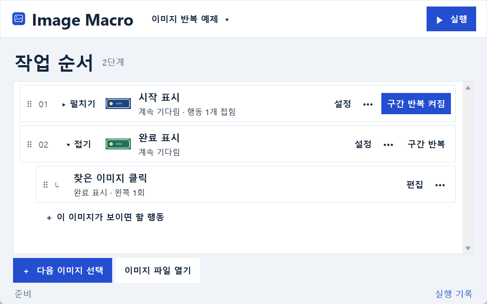

# Image Macro

Windows 화면에서 지정한 이미지가 보이면 마우스와 키보드 행동을 실행하는 데스크톱 앱입니다. 이미지별로 행동을 녹화하거나 직접 지정하고, 이미지가 보이는 동안 해당 카드의 행동을 반복할 수 있습니다.



## 설치와 사용

1. [v16 Windows x64 배포](https://github.com/glasscola/Image-Macro/releases/tag/v16)에서 ZIP을 내려받아 모두 풉니다.
2. 압축을 푼 Image Macro 폴더의 `Image Macro.exe`를 실행합니다.
3. **화면에서 대상 선택**으로 이미지를 등록하고, 카드 안의 **이 이미지가 보이면 할 행동**으로 클릭이나 녹화를 추가합니다.

[한국어 사용설명서 PDF (v14 화면)](docs/ImageMacro-v14-Manual-KO.pdf) · [v16 실제 클릭 검증 결과](docs/ImageMacro-v16-Benchmark-KO.md)

## 소스에서 실행

Windows와 Python이 필요합니다.

```powershell
python -m pip install -r src/requirements.txt
python src/app.py
python -m unittest discover -s src -q
```
